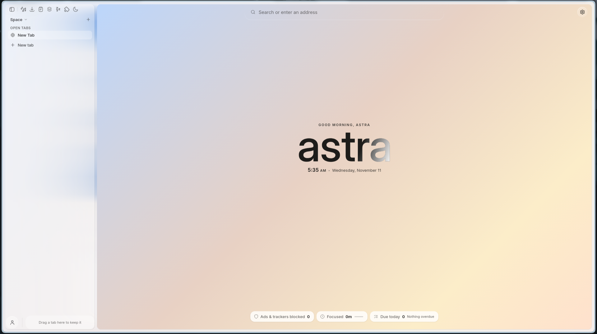
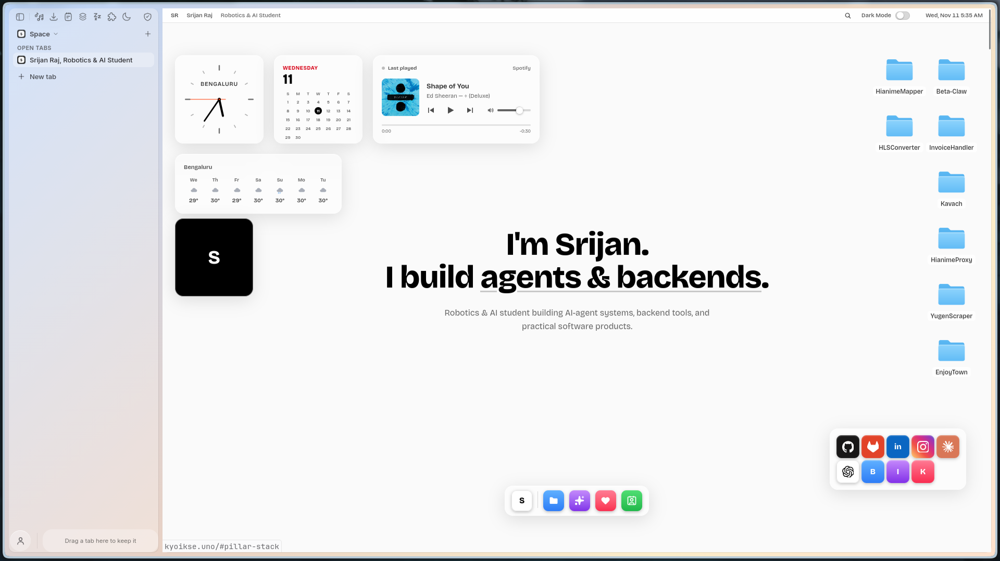

# Astra

<p align="center">
  
</p>

<p align="center">
  <strong>A calmer way to cross the web.</strong><br />
  A native, privacy-first browser for Linux — Gecko power, an interface of its own.
</p>

<p align="center">
  
  
  
  <a href="https://gitlab.com/kyoiske/astra">Repository</a>
</p>



## What is Astra?

Astra is a **native desktop web browser** built on **Firefox ESR 153.6** plus a
patch series, a chrome overlay, and a Rust sidecar. It keeps the engine it
trusts — Gecko, with its independent web compatibility and its extension model —
and replaces everything around it: the window, the tabs, the address bar, the
menus, the dialogs, the settings. Every surface you touch is Astra's own,
rendered as a first-party chrome document and wired through a host layer to the
engine. Firefox's own UI never answers.

Three ideas define it:

- **The browser is the interface.** No native menus, doorhangers, tab boxes or
  context menus left answering your actions. One UI, one design language, no
  duct tape.
- **Privacy is architecture, not a toggle.** An in-tree blocker, fingerprinting
  protection, tracker stripping and strict private-window isolation are built
  in — there is no account, no sync server, no telemetry to opt out of.
- **It starts with the person.** Spaces for separate lives, a sidebar that
  adapts, a platform passkey authenticator on Linux, restore that actually
  restores. The browser molds to the day, not the other way round.

> **Status: beta, Linux-first.** Astra runs today as a daily-usable dev build on
> Linux x86_64, verified surface-by-surface with live probes against the packaged
> browser. Accounts, sync, the AI/Work surfaces and the Windows/macOS ports are
> deliberately out of scope for now.

## The story

The mark is a sail — the oldest interface between a person and something vast.
You set it, and the open space starts to move with you. The star is never drawn;
it is implied by the act of navigation, which is what Astra actually sells: a
calmer way to cross the web.

The web grew louder: every page a negotiation with banners, trackers, prompts
and pop-ups, every browser either feeding that economy or bolting a blocker on
top of a UI designed in 2008. Astra's bet is that the engine and the interface
are separable problems — take the best independent engine, give it a humane
interface, build privacy into the structure instead of the settings page, and
verify every surface on the real build instead of declaring it done when it
renders.

## Features

Everything below works in the running browser and is covered by contract tests
plus live Marionette probes against the packaged dev build.

### A new tab worth opening

A greeting that knows the time of day, a live clock, your focus streak, today's
tasks and how many trackers died trying — on a sky that shifts with the hour.
No news feed, no sponsored tiles, no noise.

### Browse your way

| Area | What you get |
|---|---|
| Shell | Custom window frame, vertical tab strip with pinned tabs, folders, drag-and-drop and context menus, tab reorder + MRU + duplicate + switch-to-open, split view with layout persistence, hover peek cards, DOM fullscreen stage |
| Omnibox | Ranked suggestions, local search engines (Google default), private-window aware |
| Spaces | Separate lives via containers + profiles, tab groups, per-window isolated models, space icons/themes saved with live favicon previews |
| Never lose anything | Session snapshot/restore, history + bookmarks mirrored into Places with favicons, downloads manager with PDF viewer, importers for Chromium, Firefox and Zen |
| Fast by default | Tab sleeping policy, instant first paint (271 ms reveal gate), incremental `--faster` rebuilds |



### Privacy built into the walls

| Area | What you get |
|---|---|
| Blocker | In-tree ad/tracker blocking (Super Adblock 482/482), cosmetic filtering + click-to-hide, fingerprinting protection, tracker query + referrer trimming, email pixel stripping, per-site shield |
| Passkeys | Linux platform authenticator built in — create and sign in with resident-key credentials, Astra PIN sheet, encrypted vault (AES-256 + PBKDF2-600k), private-window safe |
| Isolation | No accounts, no sync, no telemetry; private windows persist nothing; per-site permissions with Astra's own prompts (geo, camera, mic); 15 verified policies, audited network endpoints |

### A browser that works around you

| Area | What you get |
|---|---|
| Tasks and notes | Task lists with priorities and natural-language parsing, Markdown notes with watcher, per-site time tracking with focus mode, JSON/Markdown export |
| Media | Now-playing pop-out, picture-in-picture, per-site media controls |
| Extensions | Manager with curated gallery, manifest adaptation (MV3 worker → event page, sidebar → sidebar action), 55-package corpus support |
| Craft | Full keymap with customizable shortcuts, command palette, welcome/onboarding flow, Astra-owned context menus, light/dark themes that reach page content, loading skeletons, accessibility pass |

> In the lab, off by default: agent Work surfaces, the Ask Astra AI assistant
> (local + BYO providers, skills, memory, MCP tools) and account sync exist
> behind build flags. They ship off in Beta 1 until each surface passes the
> same live verification as everything above.

## How Astra compares

Honest table — Astra is a beta for one platform; the others are finished
products for all of them.

| | **Astra** (beta) | Firefox | Chrome | Brave |
|---|---|---|---|---|
| Engine | Gecko ESR 153.6 | Gecko (rapid) | Blink | Blink |
| Platforms | Linux x86_64 | All major | All major | All major |
| Interface | Own Svelte chrome, zero native UI | Native Photon UI | Native Views UI | Chromium UI + skins |
| Ad/tracker blocking | Built in-tree, no extension needed | ETP + optional uBO | Optional extension (MV3-limited) | Built-in Shields |
| Fingerprinting resistance | Built-in (FPP + overrides) | FPP optional | Minimal | Built-in |
| Passkeys on Linux | Built-in platform authenticator | Via OS/desktop | Via OS/desktop | Via OS/desktop |
| Telemetry / account | None exists | Opt-out / optional | Account-tied | Optional, crypto-adjacent |
| Extension ecosystem | Firefox-compatible, adapted | Full AMO | Full Web Store | Full Web Store |
| Sync | Not yet (out of scope) | Yes | Yes | Yes |
| Status | Beta, verified per-surface | Stable | Stable | Stable |

Astra's case is simple: if you want Gecko with a modern, coherent interface and
privacy built into the walls instead of bolted onto them — and you run Linux —
there is nothing else shaped like it.

## Supported Linux distros

`./setup.sh` detects your distro and installs everything itself. x86_64 only.

| Family | Distros | Package manager |
|---|---|---|
| Debian | Ubuntu, Debian, Linux Mint, Pop!_OS | `apt-get` |
| Fedora | Fedora, RHEL, CentOS, Rocky, AlmaLinux | `dnf` |
| SUSE | openSUSE Leap / Tumbleweed | `zypper` |
| Arch | Arch Linux (+ derivatives reporting `ID_LIKE=arch`) | `pacman` |

Anything else stops with `unsupported distro` — open an issue with your
`/etc/os-release` and it can usually be added in minutes.

## Build it yourself

### 0. Requirements

| Need | Why |
|---|---|
| 16 GB RAM minimum, 31 GB recommended | the gkrust LTO link peaks near 10 GB |
| ~30 GB free disk | engine source ~6 GB, objdir ~16 GB, Rust targets/caches ~8 GB |
| `sudo` access | one password prompt up front for distro packages |

Everything else — Rust toolchain, Bun, system libraries — is installed by the
setup script.

### 1. Clone

```sh
git clone https://gitlab.com/kyoiske/astra.git
cd astra
```

### 2. Build (one command)

```sh
./setup.sh
```

That's it. The script asks for your `sudo` password once, then:

1. installs OS packages for your distro (compilers, GTK3, codecs, …),
2. installs Rust (rustup) and Bun if missing,
3. builds `astra-forge` (the repo's zero-dependency build tool),
4. downloads and GPG-verifies Firefox ESR 153.6, extracts it to `engine/`,
5. renders `out/mozconfig.linux` and runs `mach bootstrap`,
6. installs UI dependencies and builds the chrome bundle,
7. applies the overlay + the `patches/` series to `engine/`,
8. builds the engine and the `astra-core` sidecar, then packages.

The first full build takes roughly **70 minutes** on 16 threads. Useful variants:

```sh
JOBS=8 ./setup.sh       # engine parallelism (default 2: full-parallel link OOM-kills 31 GB machines)
./setup.sh --skip-ui    # reuse the existing chrome bundle
./setup.sh --skip-build # stop after overlay (fetch + config + UI)
./setup.sh --check      # no sudo: verify this machine runs the packaged build
```

> No-sudo environment with deps preinstalled? Use `tools/bootstrap.sh` instead —
> same pipeline minus the package installs (see `docs/astra/DEV_SETUP.md`).

### 3. Run it

```sh
./tools/run-dev.sh            # reuse out/dev-profile (settings persist)
./tools/run-dev.sh --fresh    # start from an empty profile
```

The result is also packaged as `out/release/Astra-<version>-linux-x86_64.tar.xz`
(+ `.sha256`). Extract and run `./install.sh` (per-user) or
`sudo ./install.sh --system`.

### 4. Verify your build (optional)

```sh
python3 tools/state-check.py
./tools/brand-lint.sh
bun run --filter @astra/frame check   # UI types, lint and unit tests (from ui/)
tools/perf/full-suite.sh --skip-build # contracts + live probes + benches
```

### Rebuild loop

| Changed | Command | Time |
|---|---|---|
| `ui/app/**` | `bun run --filter @astra/frame build:chrome` (from `ui/`) | ~7 s |
| `overlay/astra/**`, `patches/**` | `cargo run -q -- overlay` (from `forge/astra-forge`) | <1 s |
| any of the above | `cargo run -q -- build --faster` | ~7 s |
| `engine/**` (C++/Rust) | `cargo run -q -- build --jobs 2` | ~20 s+ |

Never run the engine build without `--jobs 2` — the link has OOM-killed 31 GB
machines. `engine/`, `out/` and all build outputs are git-ignored: they are
generated from the pinned tarball in `upstream.toml`, the tracked `patches/`
series, the tracked `overlay/` and the UI sources.

## Troubleshooting

- **`unsupported distro`** — check the table above; others need a small addition
  to `setup.sh`.
- **`gpg: Can't check signature`** — import Mozilla's key:
  `gpg --keyserver hkps://keyserver.ubuntu.com --recv-keys 14F26682D0916CDD81E37B6D61B7B526D98F035`.
  `forge fetch` refuses unverified tarballs.
- **`engine/ source absent`** — run `forge fetch` (or re-run `./setup.sh`).
- **`mach` complains about missing system libraries** —
  `(cd engine && ./mach bootstrap --application-choice=browser)`.
- **OOM during the link** — keep `JOBS=2`, close heavy apps, or build headless.
  Never link `libxul` at `-j16` on a 31 GB desktop.
- **Blank window after an overlay edit** — run `forge overlay` *before*
  `build --faster`, or dist symlinks point at the old bundle.

## Repository layout

| Path | Contents |
|---|---|
| `ui/` | Svelte 5 + TypeScript browser UI (Bun workspace) |
| `overlay/astra/` | chrome document, host modules, prefs, branding staged into `engine/astra/` |
| `patches/` | the upstream patch series (`ASTRA-NNNN`) applied by `forge overlay` |
| `crates/` | Rust workspace: core, store, IPC, proto, blocker, tasks, notes, time, … |
| `blocker/` | in-tree ad/tracker blocker component (C++ + Rust) |
| `forge/astra-forge/` | build/fetch/overlay/lint tool |
| `config/`, `branding/`, `upstream.toml` | mozconfig template, brand values, pinned upstream |
| `tests/`, `tools/` | contract tests, probes, lint and release scripts |
| `docs/` | plans, scope/state, performance reports and subsystem contracts (see `docs/README.md`) |

The authoritative development notes are in `docs/astra/DEV_SETUP.md`, the scope
contract in `docs/astra/SCOPE.md`. Contributions start with those two files —
the project builds in the open and verifies on the real build.
